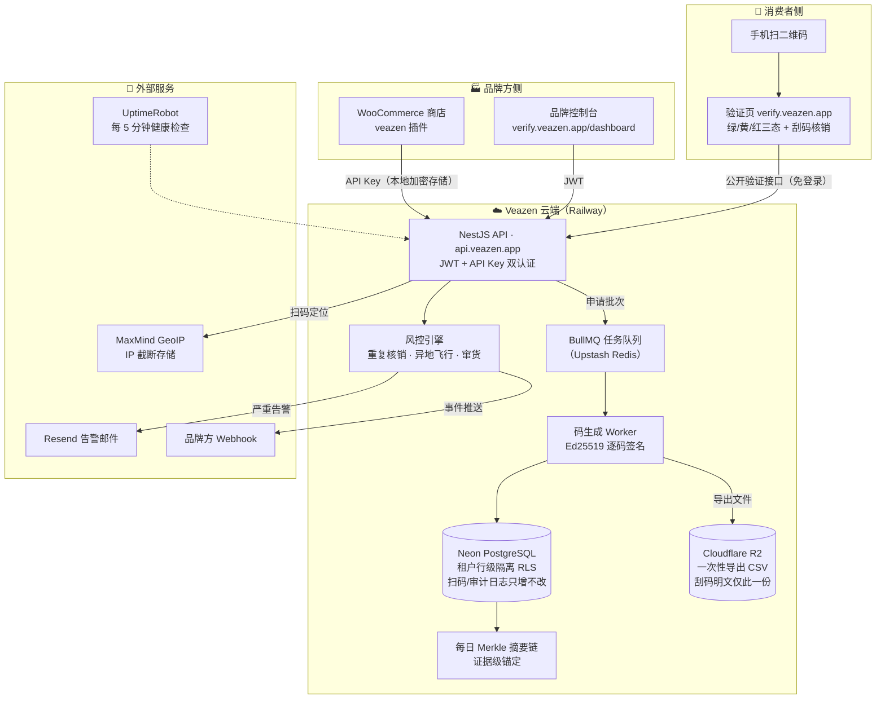
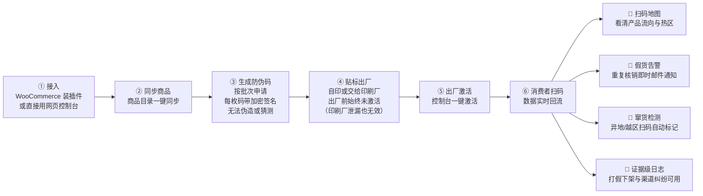
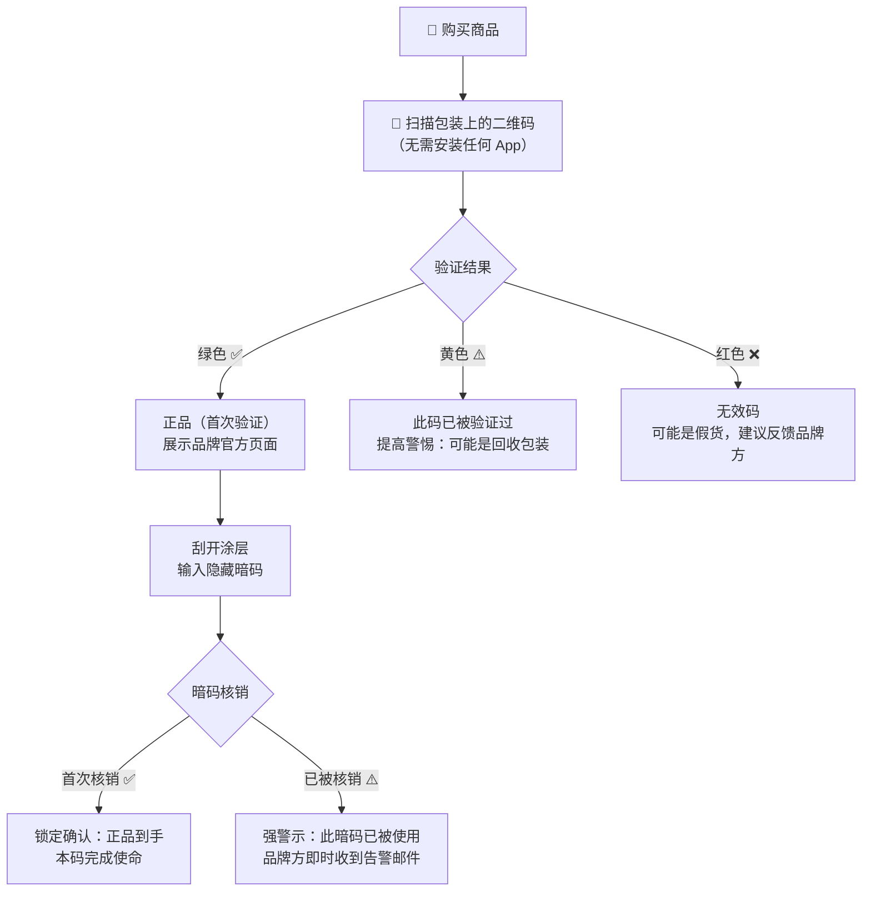

# veazen 三视角逻辑图（2026-07-13）

> GitHub 网页版可直接渲染以下 Mermaid 图。
> 三张图分别面向：技术、企业客户（品牌方）、消费者。

## 1. 技术执行与流程逻辑图

交付流水线：`GitHub main 分支 → CI 全绿 → Railway（API/验证页）与
Cloudflare Workers（官网）自动部署`。

## 2. 企业用户（品牌方）视角

一句话卖点：**每件商品一枚不可伪造的码，假货和窜货第一次变得看得见。**

## 3. 消费者使用视角

补充：Lite 模式（自印码）无刮码环节，采用**首扫锁定**——第一次扫码即绑定，
之后再扫显示"已验证过"。
